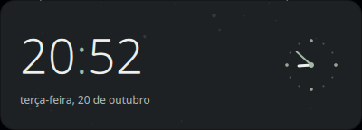

# dayzWidgets

Widgets de desktop e barra para **DankMaterialShell**, por [Matheuscara](https://github.com/Matheuscara).

Superfícies Graphite translúcidas, tipografia legível e movimento discreto. Uma
coleção com **7 plugins autorais**, **5 adaptações creditadas** e um tema opcional.
Testada originalmente em **DMS 1.4.6 + Niri**, em notebook e monitor ultrawide.



## Coleção autoral · MIT

| Plugin | Superfície | Função |
|---|---|---|
| [QuietClock](plugins/QuietClock) | Desktop | Relógio digital, data e mostrador analógico em cartões largos |
| [NordMediaCard](plugins/NordMediaCard) | Desktop | Capa, faixa, controles MPRIS e seek |
| [NordHub](plugins/NordHub) | Barra | Central de ferramentas, desempenho e clima; abre no centro da tela |
| [QuickShortcuts](plugins/QuickShortcuts) | Barra | Atalhos configuráveis por argumentos, sem shell intermediário |
| [AnimeGallery](plugins/AnimeGallery) | Desktop | Galeria de imagens locais com navegação por clique |
| [CommandShelf](plugins/CommandShelf) | Desktop | Catálogo dos comandos locais, com busca e cópia; não executa os itens |
| [BitwardenBar](plugins/BitwardenBar) | Barra | Acesso ao daemon Bitwarden compartilhado; requer integração separada |

## Versões personalizadas

Estes plugins **não foram criados do zero por este projeto**. Mantêm seus autores,
licenças, revisão de origem e descrição das mudanças em `NOTICE.md` e `plugins.json`.
Os IDs originais são preservados; substitua a instalação upstream em vez de manter
duas cópias ativas do mesmo ID.

| Plugin | Origem | Licença | Acabamento desta edição |
|---|---|---|---|
| [weatherArt](plugins/weatherArt) | [viewerofall-labs](https://github.com/viewerofall-labs/weather-viewer) | MIT | Cartão compacto para o clima nativo do DMS |
| [theGrove](plugins/theGrove) | [viewerofall-labs](https://github.com/viewerofall-labs/weather-viewer) | MIT | Planta vetorial, vaso, crescimento e próxima rega |
| [DesktopCountdown](plugins/DesktopCountdown) | [nfoert](https://github.com/nfoert/dms-desktop-countdown) | GPL-3.0 | Eventos com foto, ícone, subtítulo e dias de calendário |
| [DankAlbumWidget](plugins/DankAlbumWidget) | [kmf](https://github.com/kmf/dank-album-widget) | MIT | Capa quadrada e compatibilidade com DMS 1.4.6 |
| [DankTodo](plugins/DankTodo) | [deepu105](https://github.com/deepu105/dms-dank-todo) | MIT | Tarefas locais, host opcionalmente oculto e IPC por monitor |

## Instalar

Requer DMS/Quickshell funcionando e Python 3 para o instalador.

```bash
git clone https://github.com/Matheuscara/dayzWidgets.git
cd dayzWidgets
python3 scripts/install.py --list
python3 scripts/install.py --plugin QuietClock --plugin NordMediaCard --dry-run
python3 scripts/install.py --plugin QuietClock --plugin NordMediaCard
```

Para a coleção completa, use `--all`. O instalador cria links em
`$XDG_CONFIG_HOME/DankMaterialShell/plugins` (ou `~/.config/...`). Mantenha o clone
nesse local. Ele não reinicia o shell, não habilita plugins, não troca o wallpaper
nem regrava suas preferências. Se já houver uma pasta com o mesmo nome, recusa
substituir; `--replace` guarda a instalação anterior em um backup antes de trocar.

Depois:

1. Reinicie o DMS quando conveniente e habilite os plugins em **Configurações → Plugins**.
2. Para desktop, adicione uma instância em **Widgets do desktop**.
3. Para barra, adicione o plugin à composição da barra. Popouts precisam desse host.
4. Escolha imagens, datas e aplicativos nas configurações de cada widget.

Os atalhos para Clipboard+, OCR, Docker e Wallpaper Carousel são integrações
opcionais: esses plugins não são distribuídos aqui. O BitwardenBar requer o daemon
compatível do [fork Bitwarden](https://github.com/Matheuscara/dms-bitwarden-cli);
sem ele, o acesso fica desativado e nenhum login é feito automaticamente.

[Configuração e exemplos](docs/CONFIGURATION.md) · [NixOS](docs/NIXOS.md) · [Licenças](THIRD_PARTY.md)

## Movimento e desempenho

Animações nativas QML, de até 160–200 ms, só em interações: pressão do play,
hover das fotos e folhas. Respeitam `Theme.shortDuration=0`, sem loop decorativo.
Apenas o fundo é translúcido; texto e controles permanecem opacos. Sem blur contínuo.
O relógio atualiza por minuto; o player atualiza a posição enquanto está tocando.

## Privacidade

Não há configuração pessoal, credenciais, hosts, viagens ou inventário pré-gerado
no repositório. CommandShelf lê arquivos locais **na máquina que o executa** e pode
mostrar aliases/hosts na tela; não envia esse catálogo para servidores. O clima usa
o serviço nativo do DMS. Tarefas e imagens permanecem locais. Não há telemetria própria.

## Desenvolvimento

```bash
python3 scripts/check.py
python3 -m unittest discover -s tests -v
```

Os testes verificam parser de comandos sem executar comandos descobertos,
instalação isolada, idempotência, backups e manifests. Não são um teste visual do
shell inteiro. DMS mais recente que 1.4.6 pode alterar APIs internas; issues e PRs
são bem-vindos com versão e logs sem dados sensíveis.

## Licença

Código autoral: [MIT](LICENSE). Cada adaptação mantém sua própria licença;
**DesktopCountdown é GPL-3.0**, não MIT. Veja [THIRD_PARTY.md](THIRD_PARTY.md).
