# dayzWidgets

Widgets de desktop e barra para **DankMaterialShell**, por [Matheuscara](https://github.com/Matheuscara).

Superfícies Graphite translúcidas, tipografia legível e movimento discreto. Uma
coleção com **8 plugins autorais**, **5 adaptações creditadas** e um tema opcional.
Testada originalmente em **DMS 1.4.6 + Niri**, em notebook e monitor ultrawide.

**[Instalar](#instalar)** · [NixOS](#nixos) · [Atualizar e remover](#atualizar-e-remover) ·
[Resolver problemas](#resolver-problemas) · [Documentação](#documentação)

## O que este projeto entrega

Plugins independentes para personalizar um DMS já instalado. Escolha somente os
componentes que quiser; a coleção não instala o sistema operacional, o compositor
nem uma configuração pessoal completa.

| Tipo | Componentes |
|---|---|
| Desktop autoral | QuietClock, NordMediaCard, AnimeGallery, CommandShelf |
| Barra e popouts autorais | NordHub, QuickShortcuts, BitwardenBar |
| Seletor de wallpapers | DayzWallpapers |
| Adaptações | theGrove, DesktopCountdown, weatherArt, DankAlbumWidget, DankTodo |
| Tema opcional | Graphite |

## Coleção autoral · MIT

<p>Prévias ilustrativas com dados fictícios. Clique na imagem ou no nome para abrir o componente.</p>

<table>
<tr>
<td width="50%" valign="top">
<a href="plugins/DayzWallpapers"></a><br>
<strong><a href="plugins/DayzWallpapers">DayzWallpapers</a></strong><br>
<sub>Seletor · Categorias por pasta e troca automática configurável.</sub>
</td>
<td width="50%" valign="top">
<a href="plugins/QuietClock">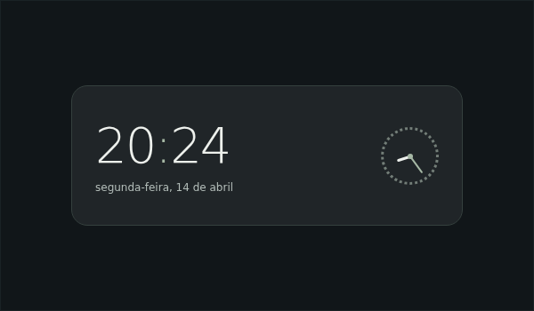</a><br>
<strong><a href="plugins/QuietClock">QuietClock</a></strong><br>
<sub>Desktop · Hora, data e mostrador analógico.</sub>
</td>
</tr>
<tr>
<td width="50%" valign="top">
<a href="plugins/NordMediaCard">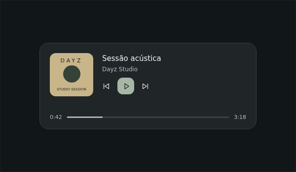</a><br>
<strong><a href="plugins/NordMediaCard">NordMediaCard</a></strong><br>
<sub>Desktop · Capa, controles MPRIS e seek.</sub>
</td>
<td width="50%" valign="top">
<a href="plugins/NordHub">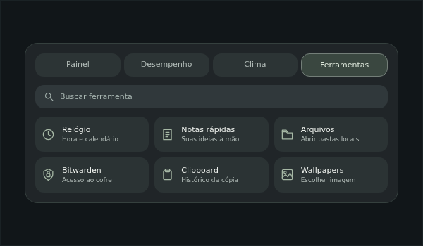</a><br>
<strong><a href="plugins/NordHub">NordHub</a></strong><br>
<sub>Barra · Central de ferramentas, desempenho e clima.</sub>
</td>
</tr>
<tr>
<td width="50%" valign="top">
<a href="plugins/QuickShortcuts">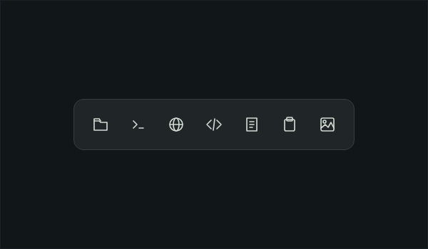</a><br>
<strong><a href="plugins/QuickShortcuts">QuickShortcuts</a></strong><br>
<sub>Barra · Acesso rápido aos seus aplicativos.</sub>
</td>
<td width="50%" valign="top">
<a href="plugins/AnimeGallery">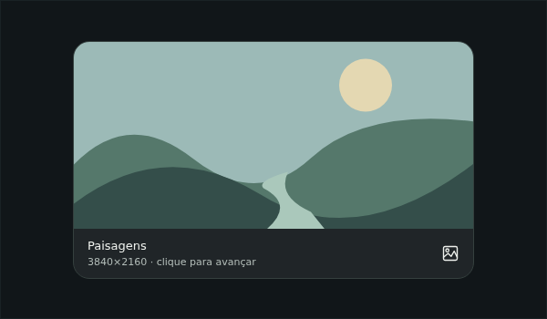</a><br>
<strong><a href="plugins/AnimeGallery">AnimeGallery</a></strong><br>
<sub>Desktop · Imagens locais e navegação por clique.</sub>
</td>
</tr>
<tr>
<td width="50%" valign="top">
<a href="plugins/CommandShelf">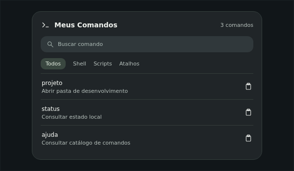</a><br>
<strong><a href="plugins/CommandShelf">CommandShelf</a></strong><br>
<sub>Desktop · Catálogo de comandos com busca e cópia.</sub>
</td>
<td width="50%" valign="top">
<a href="plugins/BitwardenBar">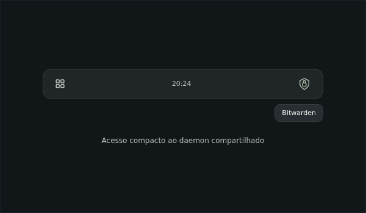</a><br>
<strong><a href="plugins/BitwardenBar">BitwardenBar</a></strong><br>
<sub>Barra · Acesso ao daemon Bitwarden compartilhado.</sub>
</td>
</tr>
<tr>
<td width="50%" valign="top">
<a href="themes/graphite.json">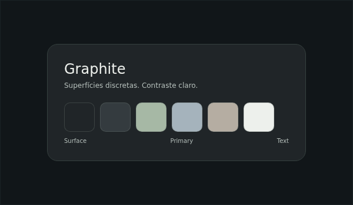</a><br>
<strong><a href="themes/graphite.json">Graphite · tema</a></strong><br>
<sub>Paleta opcional que acompanha a coleção.</sub>
</td>
<td></td>
</tr>
</table>

## Versões personalizadas

Estes plugins **não foram criados do zero por este projeto**. Mantêm seus autores,
licenças, revisão de origem e descrição das mudanças em `NOTICE.md` e `plugins.json`.
Os IDs originais são preservados; substitua a instalação upstream em vez de manter
duas cópias ativas do mesmo ID.

<p>Prévias ilustrativas com dados fictícios.</p>

<table>
<tr>
<td width="50%" valign="top">
<a href="plugins/theGrove">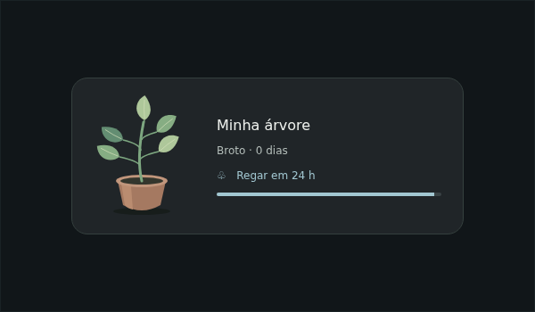</a><br>
<strong><a href="plugins/theGrove">theGrove</a></strong><br>
<sub>Planta vetorial, vaso, crescimento e próxima rega.<br>Original: viewerofall-labs · MIT · <a href="plugins/theGrove/NOTICE.md">Créditos e alterações</a></sub>
</td>
<td width="50%" valign="top">
<a href="plugins/DesktopCountdown">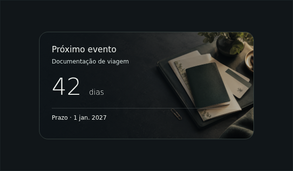</a><br>
<strong><a href="plugins/DesktopCountdown">DesktopCountdown</a></strong><br>
<sub>Eventos com imagem, subtítulo e contagem de dias.<br>Original: nfoert · GPL-3.0 · <a href="plugins/DesktopCountdown/NOTICE.md">Créditos e alterações</a></sub>
</td>
</tr>
<tr>
<td width="50%" valign="top">
<a href="plugins/weatherArt">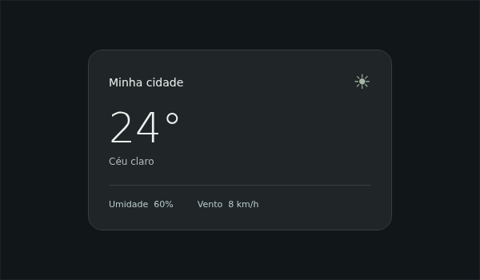</a><br>
<strong><a href="plugins/weatherArt">weatherArt</a></strong><br>
<sub>Cartão compacto para o clima nativo do DMS.<br>Original: viewerofall-labs · MIT · <a href="plugins/weatherArt/NOTICE.md">Créditos e alterações</a></sub>
</td>
<td width="50%" valign="top">
<a href="plugins/DankAlbumWidget">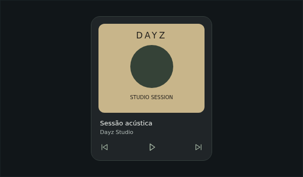</a><br>
<strong><a href="plugins/DankAlbumWidget">DankAlbumWidget</a></strong><br>
<sub>Capa quadrada e controles de reprodução.<br>Original: kmf · MIT · <a href="plugins/DankAlbumWidget/NOTICE.md">Créditos e alterações</a></sub>
</td>
</tr>
<tr>
<td width="50%" valign="top">
<a href="plugins/DankTodo">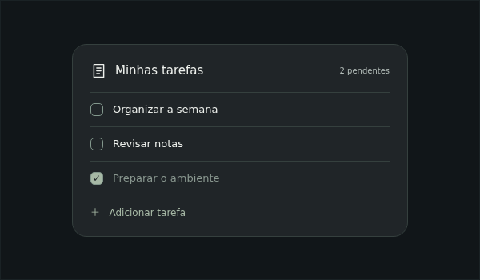</a><br>
<strong><a href="plugins/DankTodo">DankTodo</a></strong><br>
<sub>Tarefas locais e acesso por monitor.<br>Original: deepu105 · MIT · <a href="plugins/DankTodo/NOTICE.md">Créditos e alterações</a></sub>
</td>
<td></td>
</tr>
</table>

## Catálogo da comunidade

A proposta de inclusão pode ser acompanhada no
[PR do catálogo da comunidade](https://github.com/duxlabs-dev/dux-plugin-registry/pull/1063).
O estado da revisão está no próprio PR. A instalação pelo repositório funciona
independentemente da inclusão no catálogo.

## Instalar

### Requisitos

- DankMaterialShell/Quickshell já funcionando; a referência de compatibilidade
  original é DMS 1.4.6.
- Git e Python 3 para instalação pelo checkout.
- Para players, um aplicativo que exponha MPRIS.
- Para BitwardenBar, o daemon compatível indicado abaixo.

Execute como seu usuário, sem `sudo`:

```bash
git clone https://github.com/Matheuscara/dayzWidgets.git
cd dayzWidgets
python3 scripts/install.py --list
python3 scripts/install.py --plugin QuietClock --plugin NordMediaCard --dry-run
python3 scripts/install.py --plugin QuietClock --plugin NordMediaCard
```

Para a coleção completa, use `--all`. O instalador cria links em
`$XDG_CONFIG_HOME/DankMaterialShell/plugins` (ou `~/.config/...`). Mantenha o clone
no caminho em que foi instalado, pois os links apontam para ele. O instalador não
reinicia o shell, não habilita plugins, não troca o wallpaper
nem regrava suas preferências. Se já houver uma pasta com o mesmo nome, recusa
substituir; `--replace` guarda a instalação anterior em um backup antes de trocar.

Depois:

1. Reinicie o DMS quando conveniente e habilite os plugins em **Configurações → Plugins**.
2. Para desktop, adicione uma instância em **Widgets do desktop**.
3. Para barra, adicione o plugin à composição da barra. Popouts precisam desse host.
4. Escolha imagens, datas e aplicativos nas configurações de cada widget.

QuickShortcuts e NordHub usam funções nativas por padrão; integrações adicionais
são configuradas por quem instala. O BitwardenBar requer o daemon
compatível do [fork Bitwarden](https://github.com/Matheuscara/dms-bitwarden-cli);
sem ele, o acesso fica desativado e nenhum login é feito automaticamente.

### Instalar somente o seletor de wallpapers

[Dayz Wallpapers tem um repositório próprio](https://github.com/Matheuscara/dayzWallpapers),
com Python incluído e módulos NixOS/Home Manager. Com Nix e DMS instalados:

```bash
nix run github:Matheuscara/dayzWallpapers
```

Use uma única instalação do plugin: ele mantém o mesmo ID nas duas distribuições.

## NixOS

Adicione o input ao flake:

```nix
inputs.dayzWidgets.url = "github:Matheuscara/dayzWidgets";
```

Inclua `inputs.dayzWidgets.nixosModules.default` na lista `modules` do sistema,
junto ao módulo do DMS.

O módulo instala as fontes da coleção e requer que o módulo do DMS já forneça
`programs.dms-shell.plugins`. Habilitação, instâncias e preferências continuam
sendo configuradas na interface do shell. Para instalar só alguns plugins e
consultar as limitações, veja o [guia NixOS](docs/NIXOS.md).

## Atualizar e remover

Para instalações pelo checkout, dentro do clone:

```bash
git status --short
git pull --ff-only
```

Preserve alterações locais antes de atualizar. Os links passam a apontar para o
código atualizado; reinicie o DMS quando conveniente para recarregar os plugins.
Para adicionar componentes, execute novamente o instalador com `--plugin NOME`.

| Opção do instalador | Uso |
|---|---|
| `--list` | Listar diretórios, IDs, tipos e licenças |
| `--plugin NOME` | Instalar um plugin; pode repetir a opção |
| `--all` | Instalar a coleção inteira |
| `--dry-run` | Mostrar as operações sem gravar |
| `--replace` | Preservar uma instalação conflitante em backup e substituí-la |
| `--config-home CAMINHO` | Usar outra raiz de configuração |

Os backups ficam em `DankMaterialShell/backups/dayz-<data>/` dentro da raiz de
configuração. `--replace` troca a instalação, mantendo as preferências do DMS.

Para remover, desabilite o plugin no DMS, retire sua instância da barra/desktop
e remova somente o link correspondente em `DankMaterialShell/plugins/`.
Preserve preferências e backups se quiser reinstalar depois. Em instalação
NixOS, remova a declaração correspondente e aplique sua configuração normalmente.

## Resolver problemas

| Sintoma | O que conferir |
|---|---|
| Plugin instalado, mas não aparece | Habilitação em Plugins e instância no desktop ou na composição da barra |
| Instalação existente impede continuar | Reveja o destino; `--replace` preserva a instalação anterior em backup |
| Plugin parou após mover o clone | Reinstale a partir do novo caminho com `--replace` |
| Player sem capa ou controles | Abra um aplicativo com MPRIS e inicie a reprodução |
| Bitwarden indisponível | Instalação e funcionamento do daemon compatível |
| Duas versões do mesmo plugin | Escolha uma origem: coleção, upstream ou instalação declarativa |

Ao reportar um erro, informe plugin, versão do DMS, compositor, método de instalação
e passos para reproduzir. Remova credenciais e dados pessoais dos logs e capturas.

## Documentação

- [Configuração dos componentes e exemplos](docs/CONFIGURATION.md).
- [Integração declarativa com NixOS](docs/NIXOS.md).
- [Manifesto da coleção](plugins.json).
- [Origem, alterações e licenças de terceiros](THIRD_PARTY.md).
- [Prévias da galeria](docs/previews/README.md).
- Cada pasta em [plugins/](plugins/) contém a documentação do componente.

## Movimento e desempenho

Animações nativas QML, de até 160–200 ms, só em interações: pressão do play,
hover das fotos e folhas. Respeitam `Theme.shortDuration=0`, sem loop decorativo.
Apenas o fundo é translúcido; texto e controles permanecem opacos. Sem blur contínuo.
O relógio atualiza por minuto; o player atualiza a posição enquanto está tocando.

## Privacidade

Não há configuração pessoal, credenciais, hosts, viagens ou inventário pré-gerado
no repositório. CommandShelf lê arquivos locais **na máquina que o executa** e pode
mostrar aliases/hosts na tela; não envia esse catálogo para servidores. O clima usa
o serviço nativo do DMS. Tarefas e imagens permanecem locais. Não há telemetria própria.

## Desenvolvimento

```bash
python3 scripts/check.py
python3 -m unittest discover -s tests -v
# Com Qt 6 Test/Quick instalado:
QT_QPA_PLATFORM=offscreen qmltestrunner -input tests/qml -o -,txt
```

Para testar o agendamento real por 60 segundos, com SessionData isolado e imagens
fictícias: `python3 scripts/test-wallpaper-runtime.py` (requer Quickshell).

Os testes verificam parser de comandos sem executar comandos descobertos,
instalação isolada, idempotência, backups e manifests. Os testes Qt cobrem configuração,
JSON inválido, argumentos e caminhos. Não são um teste visual do
shell inteiro. DMS mais recente que 1.4.6 pode alterar APIs internas; issues e PRs
são bem-vindos com versão e logs sem dados sensíveis.

## Licença

Código autoral: [MIT](LICENSE). Cada adaptação mantém sua própria licença;
**DesktopCountdown é GPL-3.0**, não MIT. Veja [THIRD_PARTY.md](THIRD_PARTY.md).
